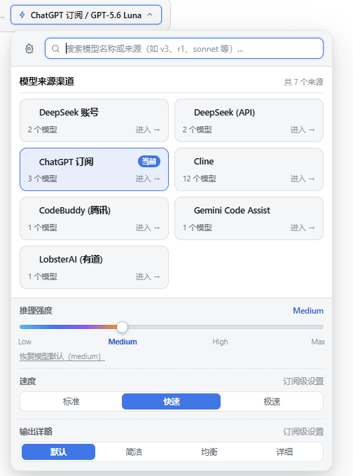
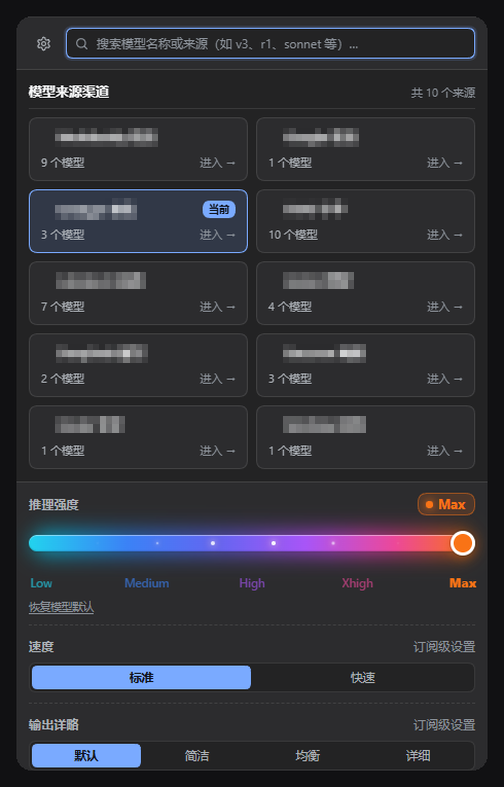
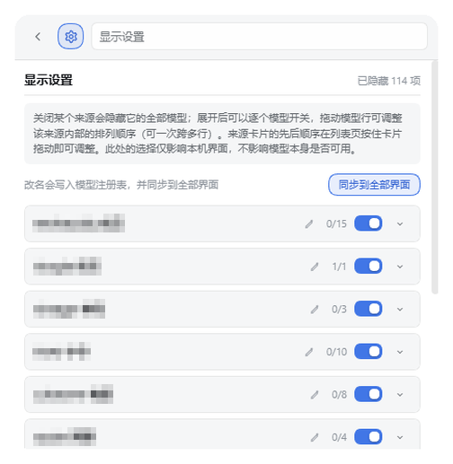
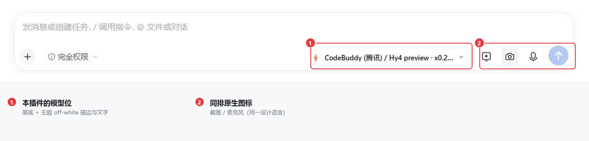

# dsh-model-block-picker

[English](README.en.md) | 中文

DeepSeek Harness (DSH) 插件 —— **按模型来源分块**的输入框模型选择器。

把官方那个「所有模型拉成一条长列表」的选择器，换成**先按来源渠道分块、再下钻进块内选模型**的两级结构；搜索、推理强度（Reasoning Effort）、模型可用性等原有能力**完全保留**。

---

## 效果

点击输入框右下角的模型位，弹出的不再是长长的平铺列表，而是**按来源分块的卡片网格**：



- **① 全局搜索** —— 直接在顶部输入 `v3` / `sonnet` / `r1`，跨全部来源聚合匹配；回车选中首项。
- **② 按来源分块** —— 每个渠道一张卡片，标出「N 个模型」与「进入 →」；卡片可拖动排序。
- **③「当前」标记** —— 正在使用的来源高亮描边 + 右上角蓝标。
- **④ 推理强度彩色滑条** —— 可拖动的 Low → Max 渐变滑条，点击刻度文字可直达。
- **⑤ 速度 / 输出详略** —— 当前模型支持时才出现，不支持则整行隐藏。

深色模式使用同一套主题 token，强调色为 `--dsw-alias-link`（`#7aaaff`），不再出现白底白字：



搜索框左侧的 ⚙ 打开**显示设置**，可按提供方整体开关，也可展开逐个开关模型：



触发按钮本身与同排的截图 / 麦克风图标保持同一设计语言（主题描边与文字）：



---

## 功能

- **按来源分块**：DeepSeek 账号、DeepSeek API，以及 CodeBuddy / Qoder / TRAE 等第三方渠道，各自成为一张卡片；卡片上显示来源名、模型数量，当前所用来源带「当前」标记。
- **两级下钻**：点卡片 → 进入该渠道内只含它自己模型的列表；顶部 `← 所有来源` 或 `Esc` 返回。
- **全局搜索**：直接输入 `v3` / `sonnet` / `r1` 等关键词即可跨所有来源聚合匹配，回车选中首项；清空即回到分块视图。
- **推理强度（彩色滑条）**：当前模型支持 reasoning 时，浮层底部出现一条**可拖动的渐变色滑条**（Low → Max 分档，带发光 thumb），点击刻度文字也能直接跳档；右侧显示当前档位，`恢复模型默认` 一键回到提供方推荐值。
- **速度 / 输出详略自适应**：订阅类提供方（如 ChatGPT 订阅）的模型若支持 `speedMode` / `outputVerbosity`，浮层底部会**额外出现对应的分段控件**；不支持的模型或提供方这两项**自动隐藏**，不会出现死开关。
- **显示设置面板**：搜索框左侧的 ⚙ 按钮打开设置，可**按提供方整体开关**、也可**展开逐个开关单个模型**是否出现在选择器里；顶部显示已隐藏数量，底部可一键恢复全部。
- **提供方拖拽排序**：卡片可直接拖动调整先后顺序（拖动时卡片半透明、目标位显示描边），松手即保存。
- **偏好持久化**：顺序、隐藏来源、隐藏模型全部写入 `localStorage`（key `dsh-model-block-picker.prefs.v1`），刷新与重启后保持；不存在的来源会在下次自动清理。
- **主题自适应**：浅色、深色均用 DSH 主题 token，深色下强调色使用 `--dsw-alias-link`（`#7aaaff`）而非会反转成近白的 `--dsw-alias-brand-primary`。

## 安装

### 从本机目录安装（开发 / 自用）

在 DSH 会话里对 Agent 说：

> 帮我安装位于 `<本仓库路径>` 的插件

Agent 会执行 `plugin_manager(action: 'install_bundle', target: '<绝对路径>')`。

安装后**彻底退出 DSH 桌面端再重新打开**（客户端 bundle 有启动基线缓存，仅刷新页面不一定加载新代码）。

卸载：`plugin_manager(action: 'remove_bundle', target: 'dsh-model-block-picker')`，回退到官方原生选择器。

## 它是怎么工作的

### 1. 覆盖官方选择器（Slot 影射）

输入框模型位是 DSH 公开的一个**命名插槽**：`conversation.input.model`（`kind: "single"`，会话作用域）。

- 官方实现注册在优先级 `-10`；
- 动态安装的插件注册同名插槽时，系统分配**更低的数值即更高优先级**获胜；
- 本插件显式注册 `priority: -20`，因此作为 winner 覆盖原生组件，卸载即自动回退。

> 注意：`single` 槽位要求同优先级唯一，所以必须用负数优先级，否则会抛
> `single slot already has a registration`。

### 2. 复用官方数据服务（不重复造轮子）

不自己请求后端。通过 `ctx.modelDirectories`：

```js
const directory = models.directoryFor(sessionId);
directory.store   // 快照：{ groups: [{ id, name, models: [...] }], current: { provider, model, reasoningEffort } }
directory.load()  // 拉取目录
directory.select({ provider, model, reasoningEffort })  // 提交选择
```

与 `/model` 命令弹窗**共用同一份会话级目录**，任一入口的切换另一入口立即可见。

### 3. 深色外观的白，来自主题而不是硬编码

早期版本手写 `#1c1f23` 之类的兜底色，在深色下不会反转，导致字和箭头变深灰。现在全部改用真实 token：

| 用途 | token | 深色取值 |
|---|---|---|
| 主文本 | `--dsw-alias-label-primary` | `#f9fafb`（off-white，非纯白） |
| 边框 | `--dsw-alias-border-l1` | `#ffffff0f` |
| 背景 | `--dsw-alias-bg-layer-1/2`、`--dsw-alias-bg-overlay` | — |
| 品牌色 | `--dsw-alias-brand-primary` | — |

深色下额外用 `body[data-ds-dark-theme]` 把触发按钮设为 `.5px` 描边 + 该 token，与右侧截图插件
（`color: var(--dsw-alias-label-primary)` + `fill:none stroke=currentColor stroke-width=1`）
保持同一笔画重量。

> **踩坑记录**：写 CSS 时**别凭印象编变量名**。DSH 里**不存在**
> `--dsw-alias-text-regular`、`--dsw-alias-border-subtle`、`--dsw-alias-surface-overlay`、
> `--dsw-alias-primary` 这些名字——它们会静默回落到你写的兜底值，浅色看着没事、深色就崩。
> 可用 `cordis_inspect_query(platform: 'client', provider: 'Theme', method: 'listTokens')` 查真实 token。

## 文件结构

```
dsh-model-block-picker/
├── package.json          # 清单：dsh.bundle.patch + dsh.client 声明
├── cordis.patch.yml      # Loader patch：把本包插进 profile 名单
├── index.js              # 宿主半边（挂 /diag 诊断路由）
├── client.js             # 浏览器半边：React 组件 + 样式 + 插槽注册
├── .github/workflows/
│   └── publish.yml       # 推 main 即发布 npm + 打 tag + 建 Release
├── scripts/
│   └── release-notes.mjs # 从 CHANGELOG 抽取当前版本的 Release 正文
├── CHANGELOG.md
├── LICENSE
└── README.md
```

## 诊断

排障时会用到：

- 宿主侧日志前缀 `[dsh-model-block-picker]`（DSH 日志里搜这个）。
- 浏览器端各生命周期节点会打到 `/plugins/dsh-model-block-picker/diag`：
  `module-evaluated` → `apply-called` → `slot-inject-triggered` → `registered-success`。
  若停在 `register-error`，说明槽位/优先级冲突；停在 `apply-error` 多半是 `inject` 未声明就访问了服务。

> **另一个坑**：客户端沙箱对服务访问有白名单。顶层 `inject` 声明了 `['slots','modelDirectories']`，
> 就**不能**再直接读 `ctx.sessions`，否则抛 `service "sessions" is not declared` 并当场崩溃。

## 已知限制

- 只替换输入框（composer）的模型位；`/model` 命令弹窗仍是官方样式（两者共用同一份数据，切换互通）。
- 已寻址的 subagent 会话不提供模型选择（沿用官方约定）。
- 来源分组顺序：默认 DeepSeek 账号 → DeepSeek 官方 → 其余按名称排；**可直接在面板里拖动卡片自定义顺序**，保存于 `localStorage`。
- 速度 / 输出详略依赖提供方暴露能力：目前只有实现了 `speedMode` / `outputVerbosity` 偏好的提供方（如 `dsh-codex-subscription` 的 `openai-codex`）会被识别；其他提供方这两项不显示。
- 偏好保存在浏览器 `localStorage`，因此**按浏览器 profile 隔离**，不随 DSH 账号同步。

## 发布流程

发版只有一步：**push 到 `main`**。

```bash
# 1. 改代码
# 2. 改 package.json 的 version
# 3. 在 CHANGELOG.md 加一个 ## [x.y.z] 段落
git push                     # ← 只有这一步会触发发布
```

`publish.yml` 随后依次完成：校验版本号 → 确认 npm 上还没有这个版本 → `npm publish`（带 provenance）→ 打 `vX.Y.Z` tag → 用 CHANGELOG 对应段落建 GitHub Release。

### 只有第一次需要手动配置

npm 那边要认这个仓库，得先建一次「信任关系」（之后永久有效）。

**前置条件：npm 账号必须已开启 2FA。** 未开启时 registry 直接拒绝可信发布器的读写（`403 Please enable 2fa for your account`），而且这个报错只在你尝试配置时出现，不会提前提示。2FA 用安全密钥（passkey / Windows Hello）或验证器 App 都行，等级选 `auth-and-writes`。

**方式一：命令行**

```bash
npm trust github dsh-model-block-picker \
  --file publish.yml \
  --repo liu19666/dsh-model-block-picker \
  --allow-publish
```

这是账号级写操作，会要求一次性口令：终端会打印一个 `https://www.npmjs.com/auth/cli/<id>` 链接（npm 11.19 起把链接里的 id 打码成了 `***`，看不到就改用下面的网页方式），在浏览器里用你的 2FA 完成验证即可。

**方式二：网页**

1. 打开 <https://www.npmjs.com/package/dsh-model-block-picker/settings>，找到 **Trusted Publisher**。
2. 选 **GitHub Actions**，填三项（区分大小写，仓库和文件名都不能带路径）：

   | 字段 | 值 |
   | --- | --- |
   | Organization or user | `liu19666` |
   | Repository | `dsh-model-block-picker` |
   | Workflow filename | `publish.yml` |

3. **Allowed actions 里勾上直接发布。** 2026-09-03 起新建的可信发布器默认只允许 `npm stage publish`（把包丢进待审队列，需要人手动 2FA 批准）。本仓库要的是无人值守直接发布，必须额外勾选 `npm publish`。漏了这一步，工作流会以 `403` 失败，而 npm 保存配置时**不会**校验这些字段，错误只会在发布那一刻才出现。
4. Environment name 留空——工作流没有声明 `environment`，填了反而对不上。

### 它不会踩的几个坑

- **不写死版本号。** 版本号的唯一来源是 `package.json`；`CHANGELOG` 段落只决定 Release 正文，漏写不会导致失败（会退回 GitHub 自动生成的 notes）。
- **幂等。** 每个 job 都先检查自己的产物是否已存在：版本已在 npm 上就跳过发布，tag 已存在就跳过 Release。所以重跑失败的任务、或者忘了改版本号又推一次，都不会重复发布，也不会有「版本号被占了但 tag 没打」这种半成品状态。
- **不需要任何 secret。** 认证走 GitHub OIDC：npm 验证的是「这个仓库、这个分支、这个工作流文件」签出的短期令牌，没有 `NPM_TOKEN` 可泄露，也无法从别人机器上重放。
- **发布前不做任何不可逆的事。** npm 版本号一旦发布就永久占用，所以版本格式、npm 是否已有该版本这些检查全在 `preflight` job 里跑完，`publish` 才会启动。
- **预发布版本不会顶掉 `latest`。** `1.2.0-beta.1` 会以 `beta` 这个 dist-tag 发布，Release 也标成 prerelease —— 否则 `npm install dsh-model-block-picker` 会给陌生人装上一个 beta。
- **`.npmrc` 里不留凭据。** `actions/setup-node` 一旦带 `registry-url`，就会往 `.npmrc` 写 `//registry.npmjs.org/:_authToken=${NODE_AUTH_TOKEN}`；可信发布场景下这个变量是故意不设的，展开成空串后 npm 会误以为「凭据已配置」，直接跳过 OIDC 交换并报 `ENEEDAUTH`（[npm/documentation#1960](https://github.com/npm/documentation/issues/1960)）。本工作流因此**不传** `registry-url`（npm 本来就默认官方源），并在发布前断言 `.npmrc` 里没有 `_authToken`，让失败指向真正的原因。

### 只想发一次 npm、不想建 Release

手动跑一次 `workflow_dispatch` 也行；或者反过来，用 `gh release create` 手工发版——工作流只认 `package.json` 的版本号，不关心是谁推的。

## 许可

MIT
